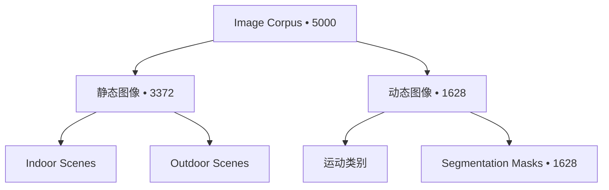

# 图像统计

!!! info "生成内容"
    当你新增、删除或重组源数据资产后，请运行 `worldarena build-docs --config config/datasets.yaml`。

## 概述

图像语料覆盖静态场景帧与带运动标签的动态静帧，分别服务于 `image_static` 与 `image_dynamic` 基准套件。下列面板从库存规模、分类覆盖、mask 监督与适用指标等角度汇总统计，再进入明细表与交互图表。

## 集合规模

总量指标, taxonomy breadth, and static/dynamic regime mix for the image corpus.

  
总量指标

  
Primary inventory counts and benchmark contract surface.

  
图像条目

  
5,000

  
全部扫描到的图像基准行

  
Mask 覆盖

  
1,628

  
32.6% 的图像条目附带分割 mask

  
正式图像套件

  
2

  
公开契约：`image_static`、`image_dynamic`

  
适用图像指标

  
46

  
`image_static` 与 `image_dynamic` 的去重指标数

  
分类拓扑 breadth

  
Distinct style, environment, motion, and resolution labels in inventory.

  
视觉风格

  
2

  
写实与风格化静帧

  
场景环境

  
2

  
室内与室外场景桶

  
运动类别

  
5

  
关节、刚体、流体与复合运动标签

  
分辨率种类

  
693

  
库存中的不同分辨率标签

  
Regime mix

  
How rows split between static layout evaluation and dynamic motion evaluation.

  

    静态图像
    67.4%
  

  
3,372

  
场景布局与相机一致性评测

  

    动态图像
    32.6%
  

  
1,628

  
运动、mask 与时序结构指标

## 基准套件

图像套件在 `config/benchmark.yaml` 中声明适用指标：静态样本侧重布局与相机一致性，动态样本额外覆盖运动与 mask 感知指标。

| suite         | regime   |   items |   metrics |
|:--------------|:---------|--------:|----------:|
| image_static  | static   |    3372 |        43 |
| image_dynamic | dynamic  |    1628 |        33 |

指标适用性与聚合语义见 [指标概览](benchmark/metrics/index.md)。

## 分类拓扑

## 静态场景汇总

| style          | environment   | scene                 |   items |
|:---------------|:--------------|:----------------------|--------:|
| photorealistic | indoor        | dining_spaces         |     169 |
| photorealistic | indoor        | living_spaces         |     169 |
| photorealistic | indoor        | public_spaces         |     169 |
| photorealistic | indoor        | workspaces            |     169 |
| stylized       | outdoor       | terrestrial_landscape |     169 |
| photorealistic | outdoor       | aquatic_landscape     |     169 |
| photorealistic | outdoor       | city                  |     169 |
| photorealistic | outdoor       | terrestrial_landscape |     169 |
| stylized       | indoor        | dining_spaces         |     169 |
| photorealistic | outdoor       | verdant_landscape     |     169 |
| stylized       | indoor        | living_spaces         |     169 |
| stylized       | indoor        | public_spaces         |     169 |
| stylized       | outdoor       | aquatic_landscape     |     169 |
| stylized       | indoor        | workspaces            |     169 |
| stylized       | outdoor       | verdant_landscape     |     169 |

## 动态 Mask 汇总

| style          | motion_category   |   items |   masked |   mask_rate |
|:---------------|:------------------|--------:|---------:|------------:|
| photorealistic | articulated       |     169 |      169 |           1 |
| photorealistic | deformable        |     169 |      169 |           1 |
| photorealistic | fluid             |     169 |      169 |           1 |
| photorealistic | multi_motion      |     168 |      168 |           1 |
| photorealistic | rigid             |     108 |      108 |           1 |
| stylized       | articulated       |     169 |      169 |           1 |
| stylized       | deformable        |     169 |      169 |           1 |
| stylized       | fluid             |     169 |      169 |           1 |
| stylized       | multi_motion      |     169 |      169 |           1 |
| stylized       | rigid             |     169 |      169 |           1 |

## 图像样例

<figure class="sample-card">
  
  <figcaption>
    <strong>Dynamic / Photorealistic / Articulated</strong>
    photorealistic/images/articulated/003.jpg
  </figcaption>
</figure>
<figure class="sample-card">
  
  <figcaption>
    <strong>Static / Photorealistic / Dining Spaces</strong>
    photorealistic/indoor/dining_spaces/000.jpg
  </figcaption>
</figure>
<figure class="sample-card">
  
  <figcaption>
    <strong>Dynamic / Photorealistic / Deformable</strong>
    photorealistic/images/deformable/000.jpg
  </figcaption>
</figure>
<figure class="sample-card">
  
  <figcaption>
    <strong>Dynamic / Photorealistic / Fluid</strong>
    photorealistic/images/fluid/001.jpg
  </figcaption>
</figure>
<figure class="sample-card">
  
  <figcaption>
    <strong>Dynamic / Photorealistic / Multi Motion</strong>
    photorealistic/images/multi_motion/001.jpg
  </figcaption>
</figure>
<figure class="sample-card">
  
  <figcaption>
    <strong>Dynamic / Photorealistic / Rigid</strong>
    photorealistic/images/rigid/000.jpg
  </figcaption>
</figure>
<figure class="sample-card">
  
  <figcaption>
    <strong>Dynamic / Stylized / Articulated</strong>
    stylized/images/articulated/000.jpg
  </figcaption>
</figure>
<figure class="sample-card">
  
  <figcaption>
    <strong>Dynamic / Stylized / Deformable</strong>
    stylized/images/deformable/001.jpg
  </figcaption>
</figure>
<figure class="sample-card">
  
  <figcaption>
    <strong>Dynamic / Stylized / Fluid</strong>
    stylized/images/fluid/000.jpg
  </figcaption>
</figure>
<figure class="sample-card">
  
  <figcaption>
    <strong>Dynamic / Stylized / Multi Motion</strong>
    stylized/images/multi_motion/000.jpg
  </figcaption>
</figure>
<figure class="sample-card">
  
  <figcaption>
    <strong>Dynamic / Stylized / Rigid</strong>
    stylized/images/rigid/000.jpg
  </figcaption>
</figure>
<figure class="sample-card">
  
  <figcaption>
    <strong>Static / Photorealistic / Living Spaces</strong>
    photorealistic/indoor/living_spaces/0000.png
  </figcaption>
</figure>
<figure class="sample-card">
  
  <figcaption>
    <strong>Static / Photorealistic / Passageways</strong>
    photorealistic/indoor/passageways/001.jpg
  </figcaption>
</figure>
<figure class="sample-card">
  
  <figcaption>
    <strong>Static / Photorealistic / Public Spaces</strong>
    photorealistic/indoor/public_spaces/002.png
  </figcaption>
</figure>
<figure class="sample-card">
  
  <figcaption>
    <strong>Static / Photorealistic / Workspaces</strong>
    photorealistic/indoor/workspaces/003.png
  </figcaption>
</figure>
<figure class="sample-card">
  
  <figcaption>
    <strong>Static / Photorealistic / Aquatic Landscape</strong>
    photorealistic/outdoor/aquatic_landscape/000.jpg
  </figcaption>
</figure>
<figure class="sample-card">
  
  <figcaption>
    <strong>Static / Photorealistic / City</strong>
    photorealistic/outdoor/city/003.jpg
  </figcaption>
</figure>
<figure class="sample-card">
  
  <figcaption>
    <strong>Static / Photorealistic / Suburb</strong>
    photorealistic/outdoor/suburb/000.jpg
  </figcaption>
</figure>
<figure class="sample-card">
  
  <figcaption>
    <strong>Static / Photorealistic / Terrestrial Landscape</strong>
    photorealistic/outdoor/terrestrial_landscape/006.jpeg
  </figcaption>
</figure>
<figure class="sample-card">
  
  <figcaption>
    <strong>Static / Photorealistic / Verdant Landscape</strong>
    photorealistic/outdoor/verdant_landscape/002.jpg
  </figcaption>
</figure>
<figure class="sample-card">
  
  <figcaption>
    <strong>Static / Stylized / Dining Spaces</strong>
    stylized/indoor/dining_spaces/001.jpg
  </figcaption>
</figure>
<figure class="sample-card">
  
  <figcaption>
    <strong>Static / Stylized / Living Spaces</strong>
    stylized/indoor/living_spaces/000.jpg
  </figcaption>
</figure>
<figure class="sample-card">
  
  <figcaption>
    <strong>Static / Stylized / Passageways</strong>
    stylized/indoor/passageways/000.jpg
  </figcaption>
</figure>
<figure class="sample-card">
  
  <figcaption>
    <strong>Static / Stylized / Public Spaces</strong>
    stylized/indoor/public_spaces/000.jpg
  </figcaption>
</figure>
<figure class="sample-card">
  
  <figcaption>
    <strong>Static / Stylized / Workspaces</strong>
    stylized/indoor/workspaces/000.jpg
  </figcaption>
</figure>
<figure class="sample-card">
  
  <figcaption>
    <strong>Static / Stylized / Aquatic Landscape</strong>
    stylized/outdoor/aquatic_landscape/000.jpg
  </figcaption>
</figure>
<figure class="sample-card">
  
  <figcaption>
    <strong>Static / Stylized / City</strong>
    stylized/outdoor/city/000.jpg
  </figcaption>
</figure>
<figure class="sample-card">
  
  <figcaption>
    <strong>Static / Stylized / Suburb</strong>
    stylized/outdoor/suburb/000.jpg
  </figcaption>
</figure>
<figure class="sample-card">
  
  <figcaption>
    <strong>Static / Stylized / Terrestrial Landscape</strong>
    stylized/outdoor/terrestrial_landscape/000.jpg
  </figcaption>
</figure>
<figure class="sample-card">
  
  <figcaption>
    <strong>Static / Stylized / Verdant Landscape</strong>
    stylized/outdoor/verdant_landscape/000.jpg
  </figcaption>
</figure>
<figure class="sample-card">
  
  <figcaption>
    <strong>Dynamic / Photorealistic / Articulated</strong>
    photorealistic/images/articulated/007.jpg
  </figcaption>
</figure>
<figure class="sample-card">
  
  <figcaption>
    <strong>Dynamic / Photorealistic / Articulated</strong>
    photorealistic/images/articulated/016.png
  </figcaption>
</figure>
<figure class="sample-card">
  
  <figcaption>
    <strong>Dynamic / Photorealistic / Articulated</strong>
    photorealistic/images/articulated/017.jpg
  </figcaption>
</figure>
<figure class="sample-card">
  
  <figcaption>
    <strong>Dynamic / Photorealistic / Articulated</strong>
    photorealistic/images/articulated/021.jpg
  </figcaption>
</figure>
<figure class="sample-card">
  
  <figcaption>
    <strong>Dynamic / Photorealistic / Articulated</strong>
    photorealistic/images/articulated/038.jpg
  </figcaption>
</figure>
<figure class="sample-card">
  
  <figcaption>
    <strong>Dynamic / Photorealistic / Articulated</strong>
    photorealistic/images/articulated/043.jpg
  </figcaption>
</figure>

## 图像分布

<iframe class="chart-frame" src="../../generated/charts/images-distribution.html" title="图像分布" loading="lazy"></iframe>

## 静态场景层级

<iframe class="chart-frame" src="../../generated/charts/images-static-scene-hierarchy.html" title="静态场景层级" loading="lazy"></iframe>

## Mask 覆盖

<iframe class="chart-frame" src="../../generated/charts/images-mask-coverage.html" title="Mask 覆盖" loading="lazy"></iframe>

## 分辨率分布

<iframe class="chart-frame" src="../../generated/charts/images-resolution-mix.html" title="分辨率分布" loading="lazy"></iframe>
