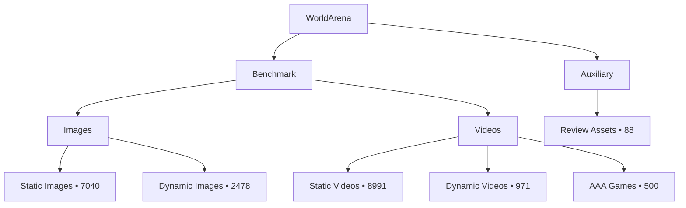

# 数据概览

!!! info "生成内容"
    当你新增、删除或重组源数据资产后，请运行 `worldarena build-docs --config config/datasets.yaml`。

  
基准条目数

  
19,980

  
主 benchmark 行数

  
图像数量

  
9,518

  
静态和动态图像资产

  
视频数量

  
10,550

  
benchmark 与辅助视频资产

  
已标注视频

  
6,250

  
带有 SpatialVID 风格元数据的行

## 拓扑

## 集合汇总

| group     | collection     | modality   |   items |   annotated |   masked |
|:----------|:---------------|:-----------|--------:|------------:|---------:|
| auxiliary | review_assets  | video      |      88 |           0 |        0 |
| benchmark | dynamic_images | image      |    2478 |           0 |      248 |
| benchmark | static_images  | image      |    7040 |           0 |        0 |
| benchmark | aaa_games      | video      |     500 |         500 |      500 |
| benchmark | dynamic_videos | video      |     971 |         319 |      319 |
| benchmark | static_videos  | video      |    8991 |        5431 |     5431 |

## 集合体量

<iframe class="chart-frame" src="../../generated/charts/overview-collection-volume.html" title="Collection Volume" loading="lazy"></iframe>

## Benchmark 层级

<iframe class="chart-frame" src="../../generated/charts/overview-benchmark-hierarchy.html" title="Benchmark Hierarchy" loading="lazy"></iframe>

## 可下载产物

- [`summary.json`](../generated/data/summary.json)
- [`all_records.csv`](../generated/data/all_records.csv)
- [`image_records.csv`](../generated/data/image_records.csv)
- [`video_records.csv`](../generated/data/video_records.csv)
