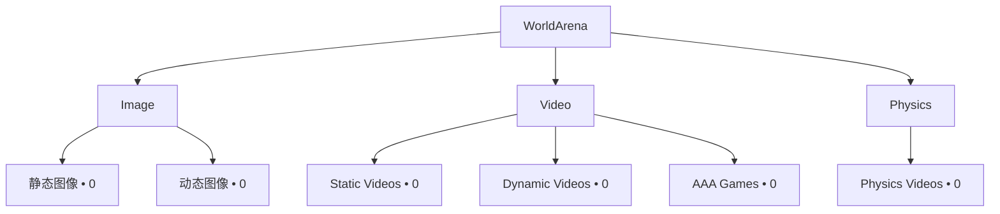

# 数据概览

!!! info "生成内容"
    当你新增、删除或重组源数据资产后，请运行 `worldarena build-docs --config config/datasets.yaml`。

  
基准条目数

  
0

  
Primary benchmark rows

  
Images

  
0

  
Static and dynamic image assets

  
Videos

  
0

  
Static, dynamic, and gameplay videos

  
Physics

  
0

  
Physics-focused video assets

## 拓扑

## 集合汇总

_No rows available._

## Collection Volume

<iframe class="chart-frame" src="../../generated/charts/overview-collection-volume.html" title="Collection Volume" loading="lazy"></iframe>

## Benchmark Hierarchy

<iframe class="chart-frame" src="../../generated/charts/overview-benchmark-hierarchy.html" title="Benchmark Hierarchy" loading="lazy"></iframe>

## 可下载产物

- [`summary.json`](../generated/data/summary.json)
- [`all_records.csv`](../generated/data/all_records.csv)
- [`image_records.csv`](../generated/data/image_records.csv)
- [`video_records.csv`](../generated/data/video_records.csv)
- [`physics_records.csv`](../generated/data/physics_records.csv)
