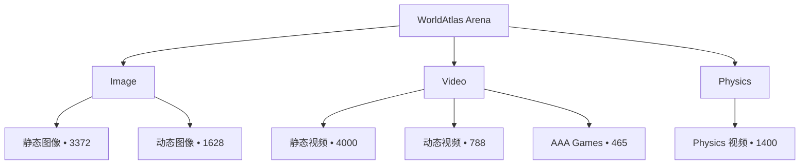

# 数据概览

!!! info "生成内容"
    当你新增、删除或重组源数据资产后，请运行 `worldarena build-docs --config config/datasets.yaml`。

快照说明：由于最近一次 `worldarena build-docs` 运行时本地数据根目录不可用，下列面板与图表使用本 checkout 中缓存的 `docs/generated/` 产物。当本地数据根目录可用时，请重新运行该命令以进行实时扫描。

## 概述

WorldAtlas Arena 将多任务基准语料、六维评估契约与世界模型适配器注册表整合在同一工作区。下列面板从媒体规模、任务范式、指标面与模型覆盖等多个角度汇总统计，再进入集合明细与样例画廊。

## 基准规模

总量指标、媒体库存、任务范式与基准契约面。

  
总量指标

  
基准条目、套件、指标与模型覆盖的主统计。

  
基准条目数

  
11,653

  
图像、视频与 physics 套件的主基准行

  
正式评测套件

  
4

  
公开基准契约，定义于 `config/benchmark.yaml`

  
文档化指标

  
47

  
基准文档中的公开指标清单

  
评估维度

  
6

  
聚合写入 `per_dimension_summary.json` 的六个主轴

  
已注册模型

  
25

  
`config/models/` 下的适配器配置

  
已标注 Rows

  
5,496

  
47.2% 的基准条目附带监督侧车数据

  
媒体库存

  
基准语料中的图像、视频与 physics 资产。

  
图像

  
5,000

  
静态与动态图像资产

  
视频

  
5,253

  
静态、动态与 gameplay 视频

  
物理

  
1,400

  
物理导向的视频资产

  
带 Mask 的动态样本

  
2,124

  
含分割 mask 的动态图像与 gameplay 条目

  
任务范式

  
基准条目在 static、dynamic、interaction 与 physics 轨道上的分布。

  

    静态世界生成
    63.3%
  

  
7,372

  
相机或布局变化下的场景一致性扩展

  

    动态世界生成
    20.7%
  

  
2,416

  
固定或受控视角下的场景内时序演化

  

    交互条件生成
    4.0%
  

  
465

  
Gameplay 与动作条件 rollout

  

    物理指标
    12.0%
  

  
1,400

  
参考运动与仿真器支持的物理评测轨道

  
评估框架

  
正式套件区分静态、动态与交互条件生成，并共享统一的报告契约；各套件在 `config/benchmark.yaml` 中声明适用的指标向量。

<table>
<thead>
<tr><th align="left">suite</th><th align="left">modality</th><th align="left">regime</th><th align="right">metrics</th></tr>
</thead>
<tbody>
<tr><td align="left">image_static</td><td align="left">image → video</td><td align="left">static</td><td align="right">43</td></tr>
<tr><td align="left">image_dynamic</td><td align="left">image → video</td><td align="left">dynamic</td><td align="right">33</td></tr>
<tr><td align="left">video_static</td><td align="left">video → video</td><td align="left">static</td><td align="right">37</td></tr>
<tr><td align="left">video_dynamic</td><td align="left">video → video</td><td align="left">dynamic</td><td align="right">43</td></tr>
</tbody>
</table>

  
按维度划分的指标

  

    长序列
    1 项指标 · 0 项官方
  

  

    

  

  

    动作控制
    12 项指标 · 4 项官方
  

  

    

  

  

    3D/4D 一致性
    7 项指标 · 2 项官方
  

  

    

  

  

    物理
    11 项指标 · 10 项官方
  

  

    

  

  

    质量
    14 项指标 · 5 项官方
  

  

    

  

  

    实时性
    2 项指标 · 2 项官方
  

  

    

  

  
官方指标 vs 补充指标

  
官方指标面

  
23

  
公开清单中进入 headline 或条件性 official 聚合的指标

  
补充指标

  
24

  
补充几何、重建与长序列补充指标

  
实验套件

  
19

  
在 `config/benchmark.yaml` 中单独声明、不计入 headline 的切片

  
指标适用性、归一化与聚合语义见 <a href="benchmark/metrics/index.md">指标概览</a>。

  

    <a href="benchmark/metrics/index.md">指标概览</a>
    <a href="benchmark/index.md">基准评测总览</a>
    <a href="development.md">开发指南</a>
  

## 拓扑

## 集合汇总

| group     | collection     | modality   |   items |   annotated |   masked |
|:----------|:---------------|:-----------|--------:|------------:|---------:|
| benchmark | dynamic_images | image      |    1628 |        1628 |     1628 |
| benchmark | static_images  | image      |    3372 |        3372 |        0 |
| benchmark | physics_videos | physics    |    1400 |           0 |        0 |
| benchmark | aaa_games      | video      |     465 |         465 |      465 |
| benchmark | dynamic_videos | video      |     788 |           0 |        0 |
| benchmark | static_videos  | video      |    4000 |          31 |       31 |

## 集合规模分布

<iframe class="chart-frame" src="../generated/charts/overview-collection-volume.html" title="集合规模分布" loading="lazy"></iframe>

## 基准分类层级

<iframe class="chart-frame" src="../generated/charts/overview-benchmark-hierarchy.html" title="基准分类层级" loading="lazy"></iframe>

## 图像样例

<figure class="sample-card">
  
  <figcaption>
    <strong>Dynamic / Photorealistic / Articulated</strong>
    photorealistic/images/articulated/003.jpg
  </figcaption>
</figure>
<figure class="sample-card">
  
  <figcaption>
    <strong>Static / Photorealistic / Dining Spaces</strong>
    photorealistic/indoor/dining_spaces/000.jpg
  </figcaption>
</figure>
<figure class="sample-card">
  
  <figcaption>
    <strong>Dynamic / Photorealistic / Deformable</strong>
    photorealistic/images/deformable/000.jpg
  </figcaption>
</figure>
<figure class="sample-card">
  
  <figcaption>
    <strong>Dynamic / Photorealistic / Fluid</strong>
    photorealistic/images/fluid/001.jpg
  </figcaption>
</figure>
<figure class="sample-card">
  
  <figcaption>
    <strong>Dynamic / Photorealistic / Multi Motion</strong>
    photorealistic/images/multi_motion/001.jpg
  </figcaption>
</figure>
<figure class="sample-card">
  
  <figcaption>
    <strong>Dynamic / Photorealistic / Rigid</strong>
    photorealistic/images/rigid/000.jpg
  </figcaption>
</figure>
<figure class="sample-card">
  
  <figcaption>
    <strong>Dynamic / Stylized / Articulated</strong>
    stylized/images/articulated/000.jpg
  </figcaption>
</figure>
<figure class="sample-card">
  
  <figcaption>
    <strong>Dynamic / Stylized / Deformable</strong>
    stylized/images/deformable/001.jpg
  </figcaption>
</figure>
<figure class="sample-card">
  
  <figcaption>
    <strong>Dynamic / Stylized / Fluid</strong>
    stylized/images/fluid/000.jpg
  </figcaption>
</figure>
<figure class="sample-card">
  
  <figcaption>
    <strong>Dynamic / Stylized / Multi Motion</strong>
    stylized/images/multi_motion/000.jpg
  </figcaption>
</figure>
<figure class="sample-card">
  
  <figcaption>
    <strong>Dynamic / Stylized / Rigid</strong>
    stylized/images/rigid/000.jpg
  </figcaption>
</figure>
<figure class="sample-card">
  
  <figcaption>
    <strong>Static / Photorealistic / Living Spaces</strong>
    photorealistic/indoor/living_spaces/0000.png
  </figcaption>
</figure>

## Physics 样例

<figure class="sample-card">
  
  <figcaption>
    <strong>Basic Physics Consistency / Acceleration</strong>
    videos_by_category/basic_physics_consistency/acceleration/00c09d36eacc9b6bc61a368fff295cd06af132b25e4ed4613ed984b1c81ff31c.mp4
  </figcaption>
</figure>
<figure class="sample-card">
  
  <figcaption>
    <strong>Basic Physics Consistency / Uniform Motion</strong>
    videos_by_category/basic_physics_consistency/uniform_motion/06fc5a6aabdcb34a7f9d111775787a3d724b53e086081aae2fd6b6dbc5ce09e8.mp4
  </figcaption>
</figure>

